# dwz · 短链与私域活码

一个跑在 Cloudflare 上的**短链 + 私域活码**平台：把长链接变短、把群二维码做成永久有效、
把每次扫码归好源，后台能看见数据 —— 而这一切只需要**一个 Worker**，不用买服务器、不用运维。

## 这是什么

面向做**私域推广**的人（社群运营、活动落地、渠道分发）的一套自建工具，一个后台管四类东西：

- **短链** —— 把长链接压短，按设备 / 平台分流，限制访问来源，看点击数据；
- **活码** —— 一个固定二维码背后挂多张群二维码，满 200 人自动换下一张，群无限加；
- **客服码** —— 一个码后面挂多个客服微信号，按阈值或随机分流，还能配在线时段；
- **渠道码** —— 给不同渠道发不同的码，谁带来的流量一目了然。

配套还有卡密（发码 / 兑换）、素材库（图片集中托管）、域名池（多域名轮询防封）、
通知渠道与定时巡检，以及一套**全量开放 API** —— 后台能点的，脚本和 AI 助手都能调。

## 我们解决什么

自己拉群、发活动的人，通常会在这些地方翻车：

- **群二维码 7 天就过期**，微信群超 200 人不能扫码进 —— 群码要天天换，发出去的图全是死链，
  只能靠「人肉换码」。活码就是干这个的：对外一个永久码，进来的人自动分到当下还有位置的群。
- **短链平台是别人的，数据也是别人的** —— 免费短链限速、带广告、随时封停，跳转规则改不了，
  数据拿不到。自建以后，分流、限流、统计、过期跳转全在自己手里。
- **推广渠道像一笔糊涂账** —— 同一张图发到十个群 / 十个号，事后没人分得清流量从哪来。
  渠道码把来源绑在码上，按 App、系统聚合，一眼看出哪个渠道在起作用。
- **多域名怕被封** —— 单一域名被微信拦了就全线停摆。域名池轮询 + 可用性巡检，
  坏一个自动换下一个。
- **不想为一个小工具养服务器** —— 部署在自己 Cloudflare 免费额度里，零服务器成本，
  数据落在自己的账号下，不经过任何第三方。

## 为什么是「一个 Worker」

前后端、跳转、定时任务全在一个 Cloudflare Worker 里：**没有 Pages、没有后端服务器、没有数据库运维**。
D1 存数据、KV 做缓存、R2 放素材，全在 Cloudflare 免费额度内。跳转和落地页由服务端直出 HTML，
不依赖前端 JS —— 微信内置浏览器里不会白屏，也没有二次跳转。

[](https://deploy.workers.cloudflare.com/?url=https://github.com/cnblove/dwz)

**仓库地址**

- CNB（主仓库）：<https://cnb.cool/cnblove/dwz>
- GitHub（镜像）：<https://github.com/cnblove/dwz>

代码同时托管在 CNB 与 GitHub 上：CNB 是主要的开发与流水线平台，GitHub 用作镜像与一键部署入口。

## 一键部署（Deploy to Cloudflare）

点顶部那颗 `Deploy to Cloudflare` 按钮，它会 fork 到你名下、自动建好 D1 / KV / R2 并绑定，
再把 Worker 部署上去 —— 全程在浏览器里点，不用装 wrangler、不用买服务器。约 10 分钟。

部署后还有两步收尾（补 `VISITOR_SALT`、跑一次数据库迁移），以及「本仓库的按钮是给 fork 用的」
这类坑，都写在 **[部署教程 · 方式一](docs/DEPLOY.md#方式一一键部署deploy-to-cloudflare)** 里。

不想用按钮的话，[手动 wrangler](docs/DEPLOY.md#方式二手动部署wrangler-cli)
与 [CNB 流水线](docs/DEPLOY.md#方式三cnb-流水线自动部署) 效果一样，
完整步骤（含自定义域名、常见排错）见 **[docs/DEPLOY.md](docs/DEPLOY.md)**。

## 演示

线上演示环境：**<https://dwz-api.1007479270.workers.dev>**

- 后台入口就是根路径 `/`，登录后可看到概览、短链、活码、渠道码、卡密等全部页面
- 短链形如 `https://dwz-api.1007479270.workers.dev/{slug}`，与后台同域
- 兑换页：`https://dwz-api.1007479270.workers.dev/redeem`

演示环境的数据随时可能被清空，仅供功能预览，不要放真实业务。

### 后台截图

| 概览 | 短链 |
| --- | --- |
| 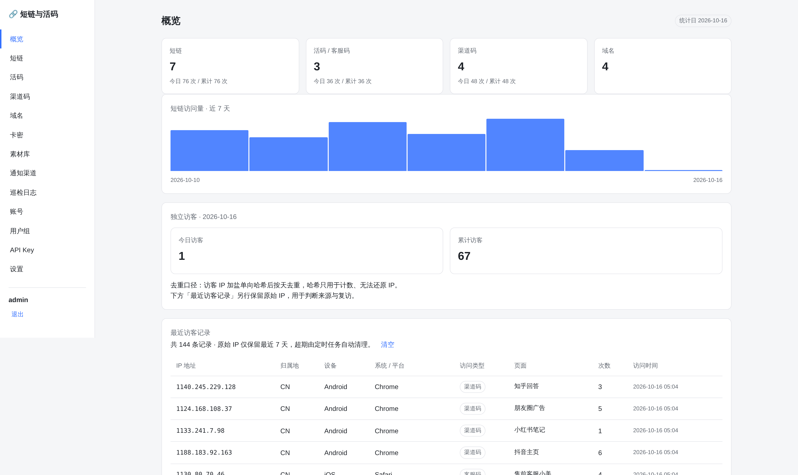 | 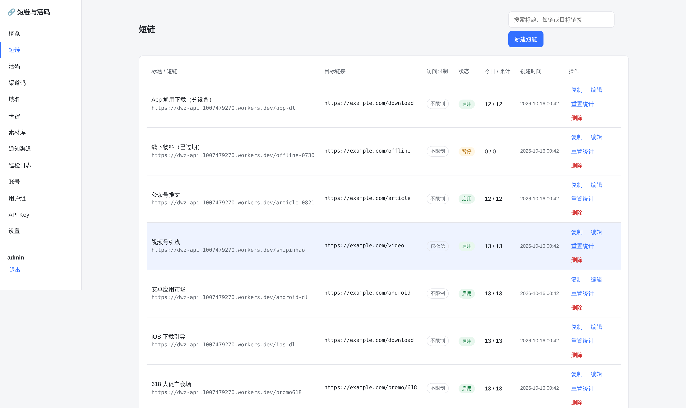 |

| 活码与客服码 | 渠道码 |
| --- | --- |
| 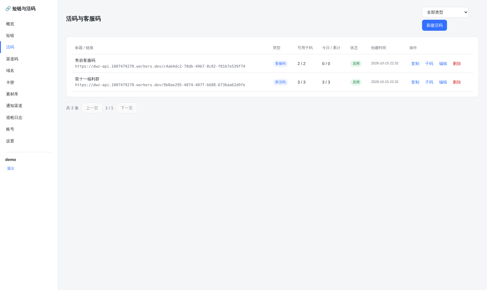 | 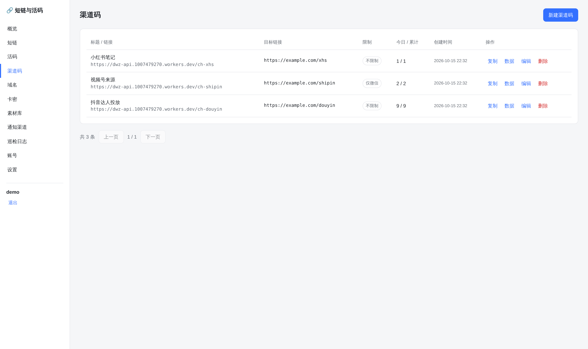 |

| 卡密 | 素材库 |
| --- | --- |
| 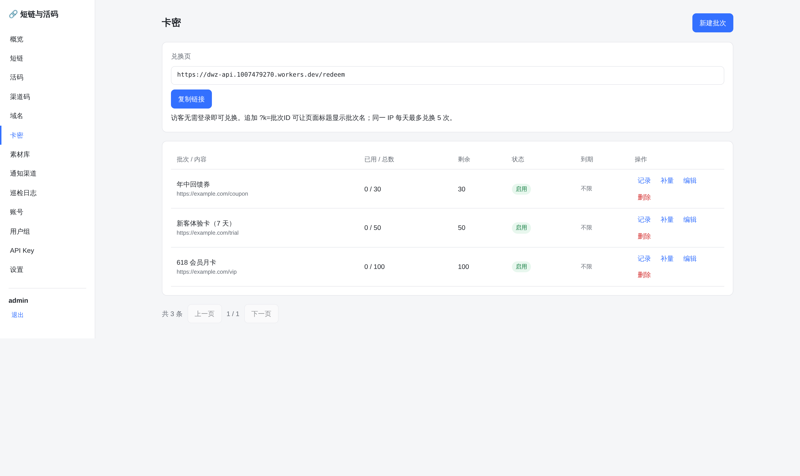 | 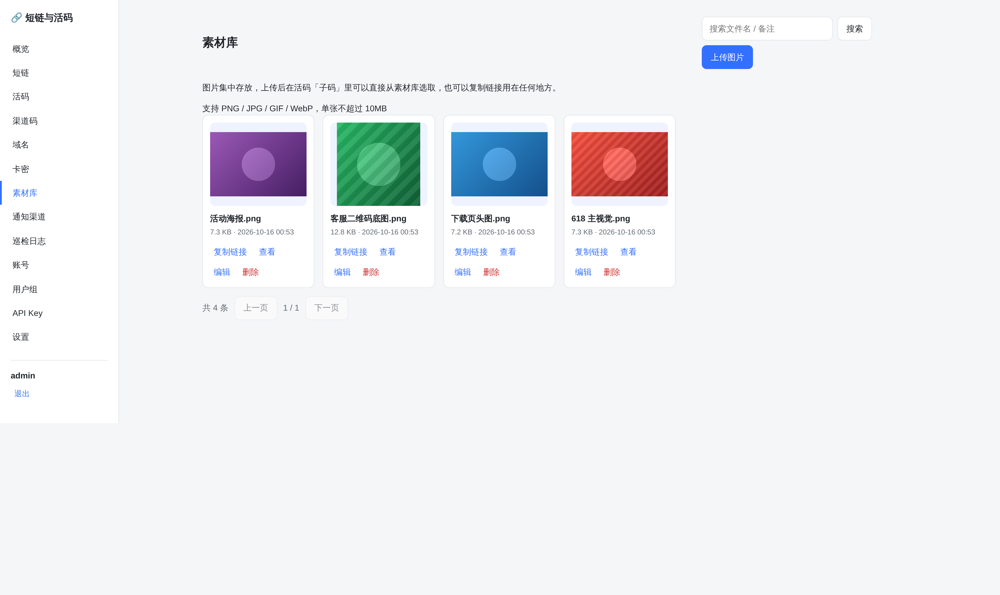 |

| 域名 | 通知渠道 |
| --- | --- |
| 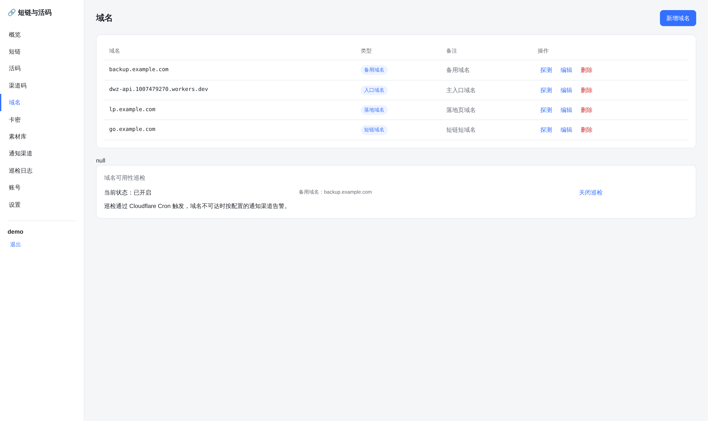 | 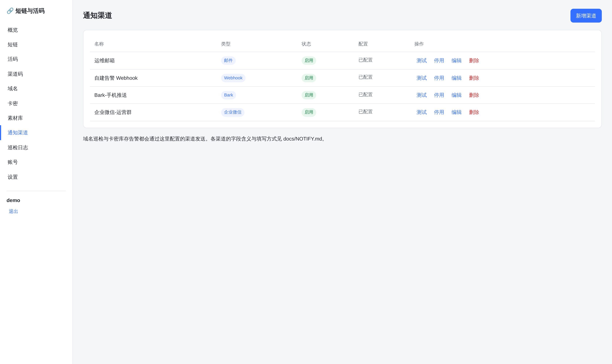 |

| 巡检日志 | 用户组 |
| --- | --- |
| 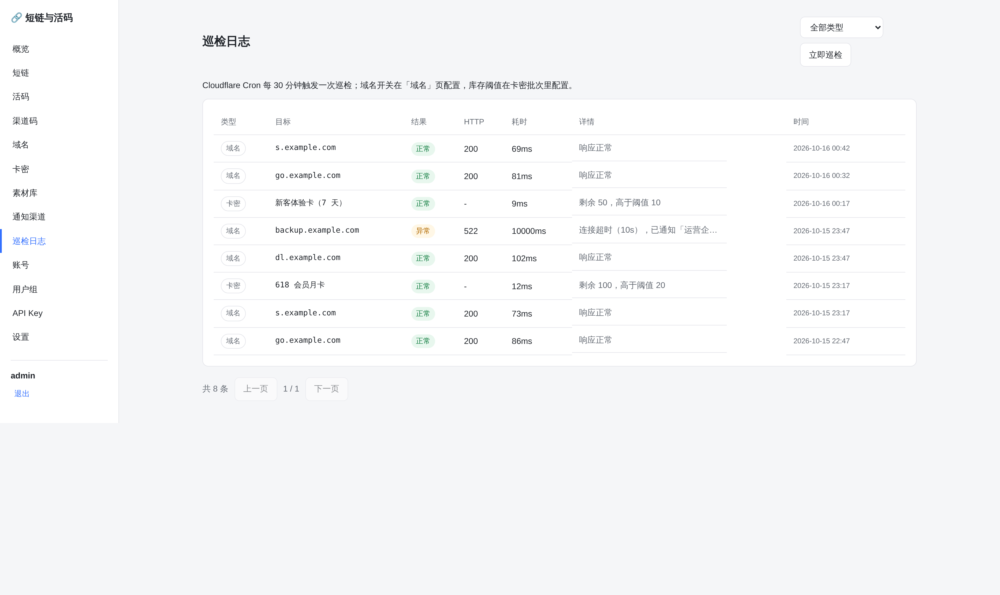 | 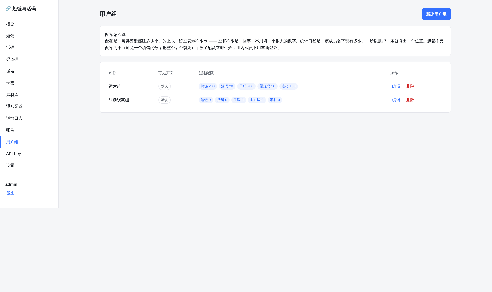 |

| 账号管理 | 开放接口（API Key） |
| --- | --- |
| 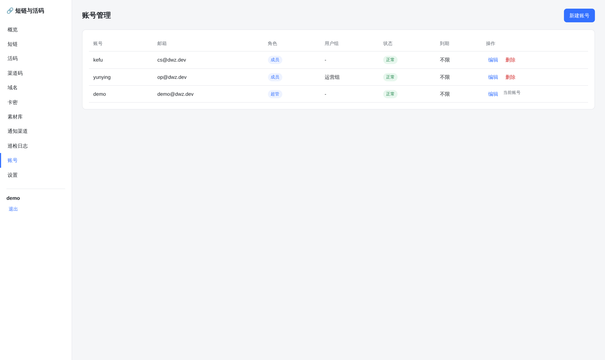 | 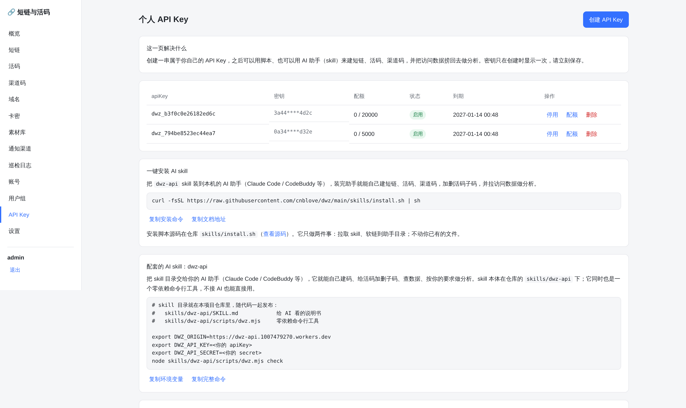 |

登录页：

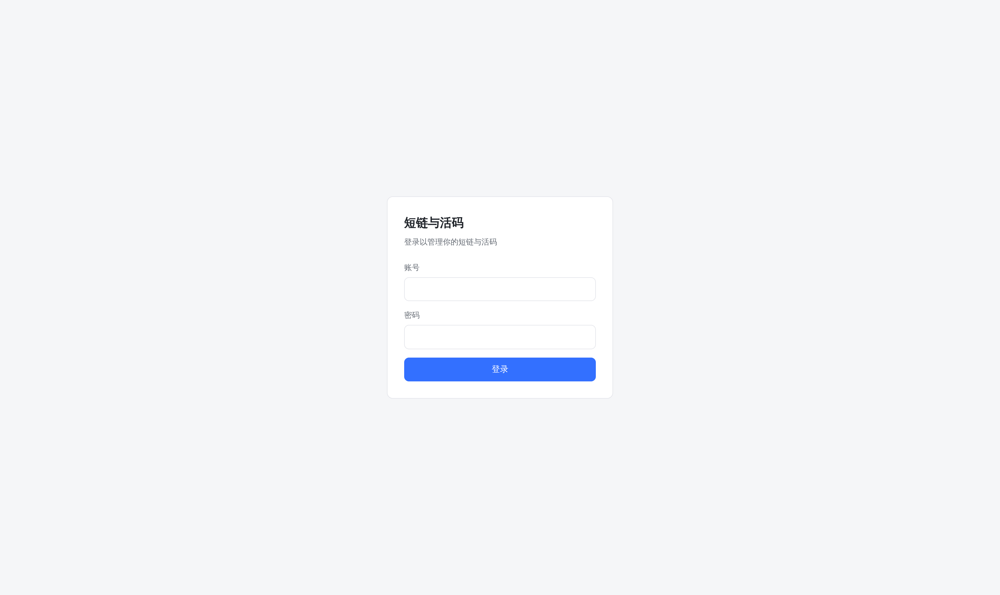

截图取自本地 `npm run dev` 起的完整环境（存了演示数据），与线上演示站同一套代码。

## 功能

| 模块 | 能力 |
| --- | --- |
| 短链 | 自定义或随机 key、按设备分流（iOS / Android / 桌面）、访问限制（微信 / 手机 / 电脑）、有效期与过期跳转、入口域名轮询、访问统计 |
| 活码 | 群活码按阈值轮换多张群二维码；访客去重（同一人固定看同一张）；子码全部触顶后可回落到兜底客服码 |
| 客服码 | 阈值 / 随机两种选取模式；展示客服微信号并一键复制；按周配置在线时段并展示在线状态 |
| 渠道码 | 短链 + 来源归因，按 App / 操作系统聚合访问数据，支持按 IP 封禁访客 |
| 域名 | 入口 / 落地 / 短链 / 备用四类域名池，支持可用性探测 |
| 卡密 | 批次化生成、明文只出一次（库存哈希）、公开兑换接口、按 IP 每日限流、库存阈值告警 |
| 通知渠道 | Webhook / 邮件 / Bark / 企业微信 / 方糖 / PushPlus，统一消息体，支持测试发送 |
| 定时巡检 | Cloudflare Cron 每 30 分钟检查域名可达性与卡密库存，异常经通知渠道告警，结果可回溯 |
| 开放 API | HMAC-SHA256 签名 + `dv1_*` 版本化契约；**后台能点的都能调**：三类码增删改查、活码子码、访问分析、域名 / 卡密 / 素材 / 通知 / 用户 / 巡检，还能用 API 自助发 Key；自带 AI skill |
| 账号 | 超管 / 成员两级角色，用户组可控制后台可见页面与**创建配额**（短链 / 活码 / 子码 / 渠道码 / 素材，留空 = 不限额），登录会话、改密踢线、操作审计 |
| 素材库 | 图片上传到 Cloudflare R2 集中托管，列表可复制链接，活码子码可直接从素材库选取，避免到处粘外链 |

访问限制、过期拦截、阈值轮换这些判断全部在**服务端**完成，不依赖前端 JS —— 微信内置浏览器里不会出现白屏或二次跳转。

后台是**响应式**的：手机、平板、桌面同一套页面，窄屏把侧边导航收成顶栏、表格转成卡片、
弹窗按钮竖排铺开，320px 到 2560px 都不会出现横向滚动。手机上换码、看数据不用再开电脑。

### 成员创建配额

配额配在**用户组**上（不是逐个账号），有五类资源各自的上限：短链、活码、子码、渠道码、素材。
留空表示不限额 —— 空和不限是一回事，不用填一个「大到像没限制」的数字。

两条口径值得说清楚：

- **只对成员生效，超管不受限。** 超管是兜底账号，把限制也压在它身上，
  配错一个 `0` 就会让整个后台再也建不出东西，而且没有第二个人能改回来。
- **算的是「该成员名下现有多少」，不是「累计建过多少」。** 所以删掉一条就腾出一个位置。
  否则总量满了就成了死局：谁都不能再建，也没人知道该删谁的。

改了配额立即生效，组内成员不用重新登录。参考项目的运营同学提的正是这条
（「限制成员能创建多少群码，要不然无脑创建很容易死」）。

## 架构

```
浏览器 ──► Worker (dwz-api)
             ├─ 静态资源（管理后台 SPA，assets 绑定）
             ├─ /{slug} 跳转与落地页（服务端直出 HTML）
             ├─ /api/* 后台接口、/open/* 开放接口
             ├─ /media/{key} 素材回源（从 R2 读出）
             ├─► D1     业务数据与统计
             ├─► KV     短时缓存
             └─► R2     素材图片对象
```

- **一个 Worker 干完所有事**：静态资源、跳转、接口、Cron 巡检都在同一个 Worker 里，不需要 Pages。
- 后台与短链**天然同域**：`https://你的域名/` 是后台，`https://你的域名/abc123` 是短链。
- 短链、活码、渠道码**共用同一个 slug 命名空间**，跳转时按 短链 → 活码 → 渠道码 的顺序命中。

> 后台路由是固定的一张表（见 `packages/worker/src/lib/assets.js`），Worker 靠它区分
> 「这是后台页面」与「这是短链 key」—— 两者都是不带扩展名的单段路径，平台层分不清。

### 数据模型

核心表（完整定义见 `packages/worker/migrations/0001_init.sql`）：

- `users` / `user_groups` / `sessions` —— 账号、授权页面、登录会话（令牌只存哈希）
- `short_links` —— 短链
- `codes` / `code_qrcodes` / `code_merges` —— 活码宿主、子码、并流关系
- `channels` / `channel_visits` / `channel_blocks` —— 渠道码与来源归因
- `domains` / `domain_checks` —— 域名池与巡检
- `hourly_stats` / `daily_visitors` / `daily_counters` —— 统计聚合
- `visit_logs` —— 最近访客明细（保留原始 IP，按天滚动清理，默认 7 天）
- `cardkey_batches` / `cardkeys` / `cardkey_redeems` —— 卡密批次、卡密（只存哈希）、兑换记录
- `notify_channels` / `inspection_logs` —— 通知渠道与巡检日志
- `api_credentials` / `audit_logs` —— 开放接口凭证与操作审计
- `assets` —— 素材库元数据（文件本体在 R2，库内只存 `object_key`）
- `short_slugs` —— 短链 / 活码 / 渠道码共用的 slug 命名空间（唯一性由数据库兜底）

## 快速开始

```bash
npm install

# 1) 建 D1 数据库，把输出的 database_id 填进 packages/worker/wrangler.toml
npx wrangler d1 create dwz

# 2) 建 KV 命名空间，同样填入 id
npx wrangler kv namespace create CACHE

# 2.5) 建 R2 桶（素材库用，绑定名固定为 MEDIA）
npx wrangler r2 bucket create dwz-media

# 3) 应用迁移
npm run migrate:remote          # 线上
npm run migrate:local           # 本地

# 4) 设置访客哈希盐（生产必做）
npx wrangler secret put VISITOR_SALT --config packages/worker/wrangler.toml

# 5) 部署后会按 wrangler.toml 的 triggers 每 30 分钟巡检一次
#    本地想手动跑一次：curl "http://localhost:8788/cdn-cgi/handler/scheduled"

# 6) 起本地开发（先构建后台产物，再由 Worker 一起提供）
npm run dev                     # Worker 于 :8788，后台与短链同域

# 想改前端时用 Vite 热更新（后台 :5173，已配好 /api 代理），
# 但短链与后端仍要看 :8788
npm run dev:web
```

首次打开后台会引导创建管理员账号 —— **第一个注册的账号自动成为超级管理员**，之后注册入口即关闭，只能由超管在「账号」页添加成员。

### 部署

三条路，任选一条：

1. **一键部署** —— 点 README 顶部的按钮，向导建资源、绑定、发 Worker。
2. **手动 wrangler** —— `npm run deploy`（先构建后台产物，再发 Worker）。
3. **CNB 流水线** —— 打 Tag 或页面上点部署按钮。

`wrangler.toml` 的 `[assets].directory` 指向 `packages/web/dist`，所以 **构建后台产物必须排在
`wrangler deploy` 之前**（`npm run deploy` 已经替你串好了顺序）。部署后把 `WEB_ORIGIN` /
`SHORT_ORIGIN` 改成你的域名；同域部署时两者相同，留空则回落到请求自身的 origin，不会出错。

**完整部署教程（含一键部署向导、自定义域名、常见排错）：[docs/DEPLOY.md](docs/DEPLOY.md)**

## 开放 API

对外开放接口是**全量**的：后台里能点的事情，脚本和 AI 助手都能做 ——
三类码（短链 / 活码 / 渠道码）增删改查、活码子码、访问分析、域名 / 卡密 / 素材 /
通知 / 用户 / 巡检，还能用 API 自助发 Key。

凭证在后台「API Key」页自助创建，密钥只显示一次；接口自描述，不查文档也能上手：

```bash
curl https://你的域名/open/v1   # 无需鉴权，列出全部动作、签名字段与示例
```

签名规则、各命名空间参数、curl 示例、配套 skill 的用法，全部整理在
**[docs/OPEN-API.md](docs/OPEN-API.md)**。

### 配套的 skill

仓库里的 [`skills/dwz-api`](skills/dwz-api/) 让 AI 助手 / 脚本直接调这套接口，
签名已经封装好。一键安装到本机助手：

```bash
curl -fsSL https://raw.githubusercontent.com/cnblove/dwz/main/skills/install.sh | sh
```

装完在后台「设置 → 个人 API Key」创建一对密钥，即可对助手说「帮我建一条活动短链」。
细节见 [docs/OPEN-API.md](docs/OPEN-API.md#配套的-skill)。

## 卡密兑换

后台「卡密」页按批次生成，卡密明文**只在生成时返回一次**，库里只存 SHA-256 哈希。

兑换有两种用法：

- **兑换页**：`https://你的域名/redeem`，服务端直出的表单页，无需登录，适合直接发到群里。
  地址在后台「卡密」页可一键复制；加 `?k=批次ID` 让标题显示批次名。
- **兑换接口**：给自有小程序 / 脚本调用。

接口不需要登录，但同一 IP 每天最多兑换 5 次：

```bash
curl -X POST https://你的域名/api/cardkeys/redeem \
  -H 'content-type: application/json' \
  -d '{"code": "DWZ-XXXXXXXX-XXXXXXXX-XXXXXXXX"}'
```

兑换成功返回批次内容与可选跳转地址（配了跳转地址时兑换页会自动跳过去）；
卡密只能被使用一次，重复提交会被拒绝。

## 定时巡检

`wrangler.toml` 里配了 `crons = ["*/30 * * * *"]`，每 30 分钟触发一次巡检：

- **域名**：在「域名」页开启开关后，逐个探测入口/落地/短链域名，不可达时经指定通知渠道告警；
- **卡密库存**：批次剩余量低于设定阈值时告警。

结果写入 `inspection_logs`，可在后台「巡检日志」页按类型筛选查看，也能点「立即巡检」手动触发。
通知发送失败不会让巡检任务失败 —— 日志里能看到记录，通知是尽力而为的旁路能力。

**各渠道的字段含义、统一消息体与排错：[docs/NOTIFY.md](docs/NOTIFY.md)** —— 重点是 Webhook
的 `url` / `method` / `header` 怎么填，以及接进来后会收到什么格式。

## 测试

```bash
npm test          # 264 项：单元 + 接口集成 + skill CLI 端到端（真实 SQLite 跑迁移）
npm run typecheck # 类型检查
```

测试直接用 `node:sqlite` 对迁移脚本建库，不 mock 数据层 —— 迁移写错会立刻在测试里暴露。
巡检与通知的外部依赖（fetch）在测试里注入替身，因此不需要外网也能覆盖失败分支。

## 目录

```
packages/
├── worker/
│   ├── migrations/           D1 迁移
│   ├── src/
│   │   ├── lib/              加密、时间、UA、统计、通知、开放接口底座等基础能力
│   │   ├── domain/           短链/活码/渠道码的解析、落地页渲染与定时巡检
│   │   ├── open/             开放接口的资源动作、访问分析与自描述目录
│   │   ├── routes/           各资源的业务实现 + Hono 子应用（api / open）
│   │   ├── app.js            Hono 应用装配：中间件 + 路由注册
│   │   └── index.js          Worker 入口（HTTP + Cron 调度）
│   └── test/
├── web/                     管理后台（Vite + 原生 DOM，无框架运行时依赖）
└── skills/dwz-api/           开放 API 的 AI skill + 零依赖 CLI
```

## 设计取舍

**为什么这么做**（服务端渲染、UUID 标识、HMAC 签名、卡密只存哈希、通知尽力而为……）
逐条写在 **[docs/DESIGN.md](docs/DESIGN.md)**，与技术栈、实现原理放在一起。

## 致谢

- 感谢 [CNB](https://cnb.cool/) 提供代码托管与流水线能力。本项目的开发过程使用了 CNB 的 **NPC（AI 助手）功能** —— 需求拆解、代码编写、PR 评审与文档整理都有 NPC 参与，很大程度上是「和 NPC 一起写出来的」。
- 感谢 [Cloudflare](https://www.cloudflare.com/) 的 Workers / D1 / KV / R2 免费额度，让这个项目不需要一台服务器就能跑起来。
- 感谢 [likeyun/liKeYun_ylb](https://github.com/likeyun/liKeYun_ylb) 与 [Hono](https://hono.dev/) 的作者与社区。

## 许可

MIT
